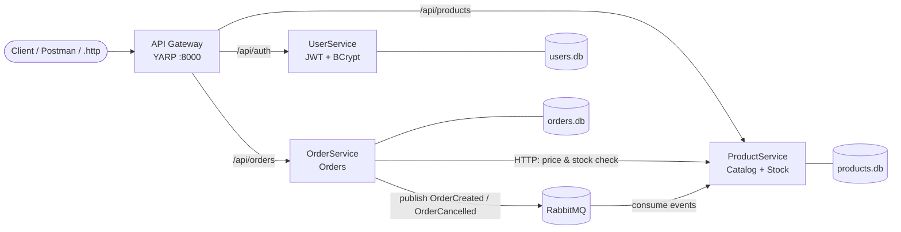

# 🛒 E-Commerce Microservices Platform (.NET)

An event-driven e-commerce backend built with **ASP.NET Core**, split into independent microservices that communicate over **HTTP** and **RabbitMQ**, secured with **JWT**, and fully containerized with **Docker Compose**.

> The whole system starts with a single command: `docker compose up --build`

---

## 📐 Architecture



**Order flow:**
1. Customer logs in through the gateway and receives a **JWT**.
2. Customer places an order → **OrderService** validates the token, then calls **ProductService** over HTTP to get the real price and check stock (the price is never trusted from the client).
3. The order is saved and an **`OrderCreated`** event is published to **RabbitMQ**.
4. **ProductService** consumes the event in a background worker and **reduces stock**. Cancelling an order publishes **`OrderCancelled`** and the stock is restored.
5. Messages use **manual acknowledgements** and **durable queues**, so if ProductService is down, events wait safely in the queue and are processed when it comes back.

---

## 🧰 Tech Stack

| Area | Technology |
|---|---|
| Language / Framework | C#, ASP.NET Core Web API (.NET) |
| Data access | Entity Framework Core, SQLite (database per service) |
| Authentication | JWT Bearer tokens, role-based authorization (Admin / Customer), BCrypt password hashing |
| Messaging | RabbitMQ (RabbitMQ.Client), event-driven communication |
| API Gateway | YARP reverse proxy |
| Containers | Docker, Docker Compose (with RabbitMQ health check) |
| Testing | xUnit, EF Core InMemory |

---

## 🧩 Services

| Service | Responsibility | Key endpoints |
|---|---|---|
| **ApiGateway** | Single entry point, routes requests to services | `:8000` |
| **UserService** | Register, login, issues JWT, seeds an Admin account | `POST /api/auth/register`, `POST /api/auth/login`, `GET /api/auth/me` |
| **ProductService** | Product catalog CRUD, stock updates from events | `GET /api/products`, `GET /api/products/{id}`, `POST/PUT/DELETE` *(Admin only)* |
| **OrderService** | Place, view and cancel orders, publishes events | `POST /api/orders`, `GET /api/orders/my`, `GET /api/orders/{id}`, `PUT /api/orders/{id}/cancel`, `GET /api/orders` *(Admin only)* |

### Security rules
- Anyone can **view** products.
- Only **Admin** can create, update or delete products (`401` without token, `403` for customers).
- Customers can only see and cancel **their own** orders; Admin can see all orders.
- Passwords are stored only as **BCrypt hashes**; login returns the same message for wrong email or wrong password to avoid leaking which emails exist.

---

## 🚀 Run It

**Requirements:** Docker Desktop

```bash
git clone https://github.com/ForgeHoldTech/ecommerce-microservices.git
cd ecommerce-microservices
docker compose up --build
```

| What | Where |
|---|---|
| API Gateway | http://localhost:8000 |
| RabbitMQ dashboard | http://localhost:15672 (guest / guest) |

A default admin account is created automatically:
`admin@ecommerce.com` / `Admin@123` *(demo only)*

Stop everything with:
```bash
docker compose down
```

### Try it
Open `ApiGateway/ApiGateway.http` in Visual Studio and send the requests in order:
register → login → view products → place an order → watch the stock change in the ProductService logs → cancel the order.

---

## ✅ Tests

17 unit tests covering the product CRUD rules and the authentication / security rules.

```bash
dotnet test
```

| Test project | What it covers |
|---|---|
| `ProductService.Tests` | Get / create / update / delete products, 404 handling |
| `UserService.Tests` | Registration, duplicate emails, password hashing, login success / failure, JWT claims and expiry |

---

## 📁 Project Structure

```
ECommerce/
├── ApiGateway/              # YARP reverse proxy
├── UserService/             # Auth: register, login, JWT
├── ProductService/          # Catalog + RabbitMQ consumer (stock)
├── OrderService/            # Orders + RabbitMQ publisher
├── ProductService.Tests/    # xUnit tests
├── UserService.Tests/       # xUnit tests
└── docker-compose.yml       # Runs the whole system
```

---

## 🔭 Planned Improvements

- Redis caching for the product list
- GitHub Actions CI pipeline (build + test on every push)
- SQL Server instead of SQLite, with EF Core migrations
- Outbox pattern so events are never lost if RabbitMQ is temporarily down
- PaymentService (Stripe test mode)
- Move secrets (JWT key) to environment variables / a secret store

---

## 👤 Author

**Usman Ahmad**, BS Software Engineering
GitHub: [github.com/ForgeHoldTech](https://github.com/ForgeHoldTech) · Portfolio: [forgeholdtech.github.io](https://forgeholdtech.github.io)
